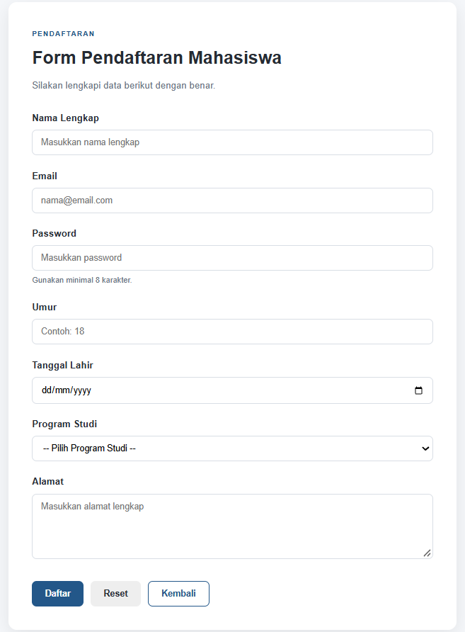
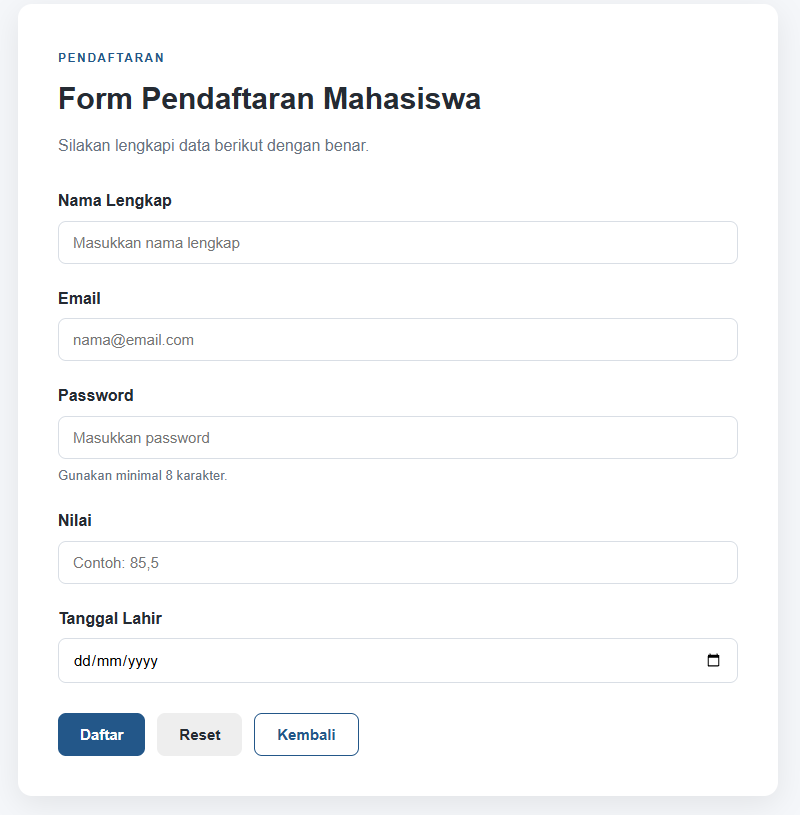
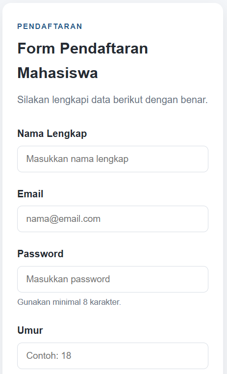
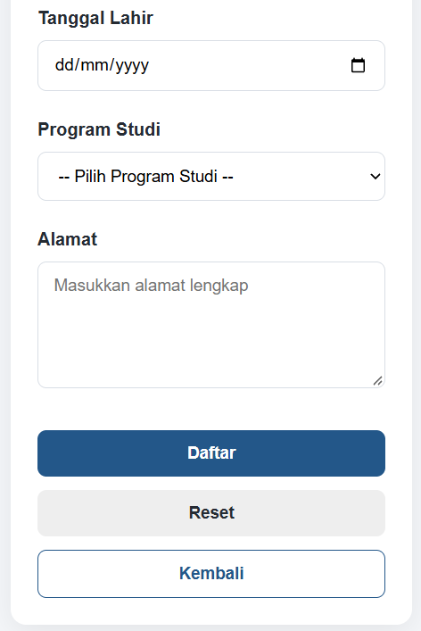
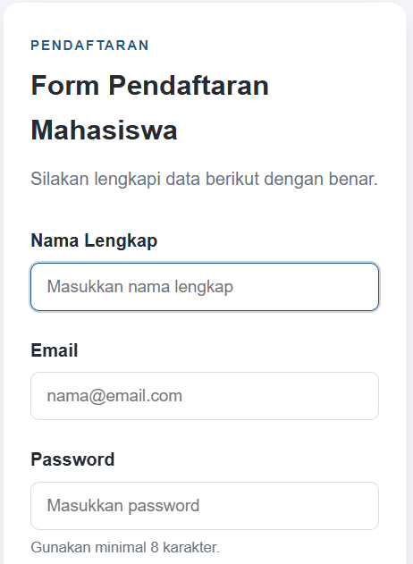
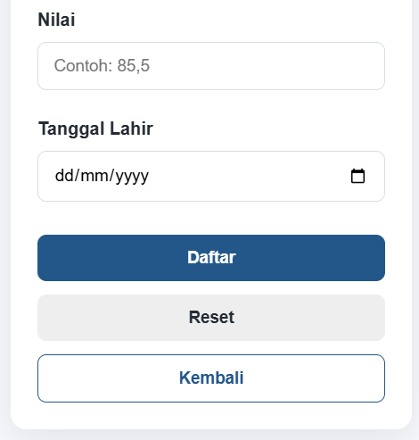

 LAPORAN PRAKTIKUM Desain Web

| Informasi Praktikan | Keterangan |
| :--- | :--- |
| **Nama** | I Gede Ardhika Arimbawa tangkas |
| **NPM** | 4525210080 |
| **Kelas** | A |
| **Mata Kuliah** | Desain Web |
| **Pertemuan** | 7 - HTML Form |

# 1. Kesimpulan Kodingan

Proyek ini adalah membentuk halaman form pendaftaran mahasiswa. index.html adalah versi lengkap (nama, email, password, umur, tanggal lahir, program studi, alamat), sedangkan form_mahasiswa.html adalah versi lebih ringkas (nama, email, password, nilai, tanggal lahir) yang digunakan untuk tugas studi kasus. Keduanya memakai style.css yang rapi: variabel warna di :root, layout kartu di tengah, gaya input yang konsisten, tombol berwarna, dan media query untuk tampilan mobile. Struktur HTML sudah semantik (main, section, label for) dan memakai method POST dengan atribut required.

## 1.1 Masalah yang ditemukan

>Beberapa konten dalam file html tidak sesuai (typo dan kesalahan teks tidak seragam).

>Saran: Pastikan konten dalam file html diketik dengan cara yang benar.

# 2. Hasil Run

## 2.1 Desktop
>Foto dalam zoom <100%

### 2.1.1 index.html

**Hasil Run:**

### 2.1.2 form_mahasiswa.html

**Hasil Run:**

## 2.2 Mobile

### 2.2.1 index.html

**Hasil Run:**

### 2.2.2 form_mahasiswa.html

**Hasil Run :**

